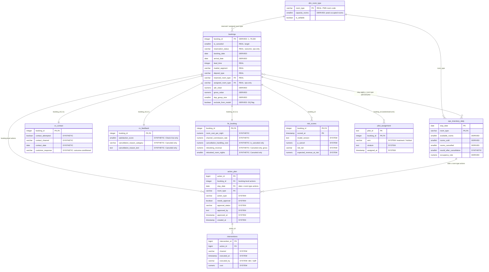
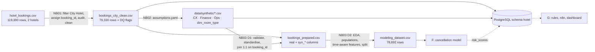

# Data architecture — City Hotel Lisbon cancellation DSS

PostgreSQL schema `hotel` (full DDL with types, keys and CHECK constraints: `sql/schema.sql`; load script: `sql/load.sql`).
Field meanings: `docs/data_dictionary.csv`. Model-feature meaning and availability time: `docs/feature_availability.csv`.

**Layers.** REAL = hotel PMS extract (Antonio et al., 2019) · DERIVED = computed only from real data · SYNTHETIC = simulated from `config/assumptions.yaml` (`is_synthetic = TRUE`) · SYSTEM = written later by the model, rule engine and n8n.

## 1. Entity-relationship diagram

## 2. Tables, grain and keys

| Table | Layer | Grain | Primary key | Rows (this build) |
|---|---|---|---|---|
| `dim_room_type` | DERIVED | room type | `room_type` | 9 |
| `bookings` | REAL (+ derived columns) | booking | `booking_id` | 79,330 |
| `cx_contact` | SYNTHETIC | booking (1:1) | `booking_id` | 79,330 |
| `cx_feedback` | SYNTHETIC | booking (1:1) | `booking_id` | 79,330 |
| `fin_booking` | SYNTHETIC | booking (1:1) | `booking_id` | 79,330 |
| `ops_inventory_daily` | DERIVED + SYNTHETIC | night × room type | `(stay_date, room_type)` | 7,227 |
| `risk_scores` · `action_plan` · `interventions` · `pilot_assignment` | SYSTEM | score / action / execution / pilot arm | surrogate or composite keys | 0 (filled in F/G) |

**Join paths.** Booking-level tables join 1:1 on `booking_id`. A booking joins to `ops_inventory_daily` through its stay nights (`stay_date ∈ [arrival_date, arrival_date + total_nights)`), using `assigned_room_type` for rooms sold and `reserved_room_type` for cancellations. Views: `v_booking_360` (one analytical row per booking, synthetic columns prefixed `syn_`) and `v_ops_daily_hotel` (hotel-level daily KPIs).

## 3. Data flow

## 4. Integration and privacy

Covered in notebook 02, Section 8: source systems, keys, grains, snapshot timing, real-time inventory, data quality, synthetic-vs-real labelling, the approval loop (recorded in `action_plan` with who/when; an execution guard is a G2 requirement), the randomised pilot assignment used for causal KPIs, and GDPR (lawful basis, minimisation, retention, Art. 22 human review, transparency, fairness, security).
